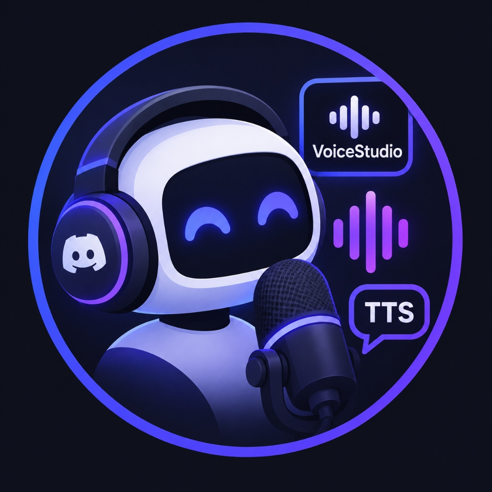
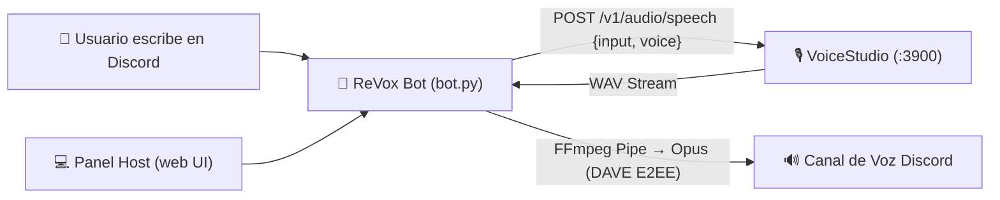

<p align="center">
  
</p>

<h1 align="center">ReVox 🎙️</h1>

<p align="center">
  <b>Bot de Discord TTS con clonación de voz local en tiempo real usando VoiceStudio.</b><br>
  <i>100% privado, local-first y sin suscripciones ni APIs de pago.</i>
</p>

<p align="center">
  
  
  
  
</p>

---

## 📖 Descripción

**ReVox** conecta tu servidor de Discord con tu instancia local de [VoiceStudio](https://github.com/debpalash/VoiceStudio). Al escribir en cualquier canal de texto vinculado, el bot sintetiza el mensaje en tiempo real usando tu voz clonada preferida y lo reproduce en el canal de voz.

Incluye una **interfaz gráfica web moderna y minimalista** para que el host pueda administrar el bot, monitorear las colas, probar audios en el navegador y ver logs en tiempo real sin tocar la consola.

---

## ✨ Características

- 🎙️ **Clonación de Voz Real:** Compatible con cualquier perfil de voz clonado en VoiceStudio (`Dokuro`, `Fetrox`, etc.).
- 🌐 **Panel Web del Host:** Dashboard moderno (Oscuro/Minimalista) en `http://127.0.0.1:5050` con inicio/parada con un clic, monitor de colas y consola de logs.
- 🎧 **Pre-escucha Local (Audio Preview):** Probá cómo suena una voz en tu navegador web antes de enviarla al canal de Discord.
- 🔒 **Protocolo DAVE (E2EE 2026):** Totalmente adaptado al cifrado obligatorio de Discord mediante `discord.py 2.7+` y `davey`.
- ⚡ **Zero Temp Files:** Transmisión de audio directa en memoria (RAM) vía FFmpeg pipes a Opus, sin escribir gigabytes de archivos temporales en disco.
- 🛡️ **Validación de Voz Estricta:** Resuelve y valida perfiles reales contra el endpoint de VoiceStudio para evitar fallbacks silenciosos.
- 📋 **Gestión de Colas:** Manejo individual por servidor con opción de saltar mensajes o vaciar la cola.

---

## 🛠️ Stack Tecnológico

| Componente | Tecnología | Versión | Rol en el sistema |
|---|---|---|---|
| **Runtime** | Python | 3.11+ | Lenguaje base del bot y del panel |
| **Discord Bot** | `discord.py[voice]` | 2.7.1 | Gateway, slash commands y streaming de voz |
| **Cifrado E2EE** | `davey` | 0.1.7 | Soporte para el protocolo DAVE exigido por Discord |
| **Encriptación** | `PyNaCl` | 1.5.0 | Criptografía de paquetes de voz para Discord |
| **Transcodificación**| `FFmpeg` | 7.0+ / 9.0 | Conversión de PCM/WAV a Opus en tiempo real |
| **Motor TTS** | [VoiceStudio](https://github.com/debpalash/VoiceStudio) | 0.5.6+ | Síntesis y clonación de voz local (puerto `3900`) |
| **Servidor Panel** | `aiohttp.web` | 3.14.5 | Servidor asíncrono, API REST y streaming SSE |
| **Configuración** | `python-dotenv` | 1.2.4 | Carga y persistencia de variables en `.env` |

---

## 📐 Arquitectura



---

## 🚀 Guía de Instalación y Replicación

### 🤖 Opción 1: Instalación Asistida con Agentes de IA (Recomendado)

Si usás un asistente o agente de IA (**Antigravity**, **Cursor**, **Claude Code**, **Codex**, etc.), solo pegale este prompt directamente:

> 📋 **Prompt para tu Agente de IA:**
> ```text
> Cloná e instalá el proyecto https://github.com/John54571/ReVox-Bot en mi máquina siguiendo las instrucciones de su AGENTS.md. Verificá los prerrequisitos del sistema (Python 3.11+ y FFmpeg), configurá el entorno virtual, inicializá .env a partir de .env.example y ejecutá el script para generar el acceso directo en mi Escritorio.
> ```

El agente leerá automáticamente [`AGENTS.md`](https://github.com/John54571/ReVox-Bot/blob/main/AGENTS.md) dentro del repositorio y dejará todo listo sin que tengas que ejecutar comandos.

---

### 💻 Opción 2: Instalación Manual

#### 1. Requisitos Previos (Windows)

Instalá Python 3.11+ y FFmpeg si aún no los tenés:

```powershell
winget install Python.Python.3.11
winget install Gyan.FFmpeg
```

> **Verificación:** Abrí una terminal nueva y comprobá que `python --version` y `ffmpeg -version` respondan correctamente.

Descargá y ejecutá **[VoiceStudio](https://voicestudio.sh)**, seleccioná un motor de TTS y creá o cloná tu voz. VoiceStudio debe permanecer abierto en segundo plano (expone su API en `http://127.0.0.1:3900`).

---

### 2. Crear tu Bot en Discord

1. Entrá a [Discord Developer Portal](https://discord.com/developers/applications) e iniciá sesión.
2. Hacé clic en **New Application**, dale un nombre (ej. `ReVox`) y entrá a la pestaña **Bot**.
3. **Paso fundamental:** Activá el switch **Message Content Intent** dentro de *Privileged Gateway Intents* y hacé clic en **Save Changes**.
4. En esa misma pantalla tocá **Reset Token**, confirmá y copiá el token generado.
5. Para invitarlo a tu servidor, entrá a **OAuth2 → URL Generator**:
   - **Scopes:** `bot` y `applications.commands`.
   - **Bot Permissions:** `View Channels`, `Send Messages`, `Read Message History`, `Connect` y `Speak`.
   - Abrí el enlace generado e invitá el bot a tu servidor de Discord.

---

### 3. Clonar y Configurar el Proyecto

```powershell
git clone https://github.com/John54571/ReVox-Bot.git
cd ReVox-Bot

# Crear entorno virtual e instalar dependencias
python -m venv .venv
.\.venv\Scripts\pip install -r requirements.txt

# Crear tu archivo de configuración personal
copy .env.example .env
```

Editá el archivo `.env` con tus datos:

```ini
# Tu token secreto copiado del Developer Portal
DISCORD_TOKEN=tu_token_aqui

# Dirección de VoiceStudio (3900 por defecto)
VOICESTUDIO_URL=http://127.0.0.1:3900

# ID de la voz a usar (ej: Dokuro = 188d7f2b)
VOICESTUDIO_VOICE=188d7f2b

# Límite máximo de caracteres por mensaje
MAX_CHARS=400

# 1 para iniciar el bot automáticamente al abrir el panel
AUTOSTART=0
```

> 💡 **¿Cómo obtener el ID exacto de tu voz en VoiceStudio?**
> Con VoiceStudio abierto, ejecutá en PowerShell:
> ```powershell
> (Invoke-RestMethod http://127.0.0.1:3900/v1/audio/voices).voices | Where-Object type -eq "profile" | Format-Table voice_id, name, language
> ```
> *(Usar siempre el `voice_id` garantiza que VoiceStudio use exactamente ese clon y no aplique la voz por defecto).*

---

#### 4. Crear Acceso Directo en el Escritorio (Opcional)

Podés crear un acceso directo en tu Escritorio con el logo oficial del bot:
- Hacé doble clic en **`crear_acceso_directo.bat`**, o
- Ejecutá en PowerShell:
  ```powershell
  powershell -NoProfile -ExecutionPolicy Bypass -File .\crear_acceso_directo.ps1
  ```

---

#### 5. Ejecución

Tenés dos formas de correr ReVox:

##### 🌟 Opción A: Panel Web de Control (Recomendado)
Hacé doble clic en el acceso directo de tu Escritorio, o en **`iniciar_panel.bat`**:
```powershell
.\.venv\Scripts\python panel.py
```
Se abrirá automáticamente tu navegador en **`http://127.0.0.1:5050`**. Desde el panel podés:
- Iniciar y detener el bot con un solo clic.
- Ver el estado de conexión de VoiceStudio y la latencia a Discord.
- Probar audios localmente en tu navegador con el botón **🎧 Probar Audio**.
- Monitorear colas de reproducción, pausar o saltar mensajes.
- Inspeccionar logs en vivo con filtro de severidad (`INFO`, `WARN`, `ERROR`).
- Editar la configuración sin tocar archivos a mano.

#### ⚙️ Opción B: Modo Headless / Terminal pura
Si preferís correr solo el bot sin interfaz web:
```powershell
.\.venv\Scripts\python bot.py
```

---

## 🎮 Comandos de Discord (Slash Commands)

| Comando | Parámetros | Descripción |
|---|---|---|
| `/entrar` | *Ninguno* | El bot se une a tu canal de voz actual y queda escuchando el canal de texto donde ejecutaste el comando. |
| `/decir` | `texto` | Envía un mensaje puntual a la cola de voz (útil desde otros canales). |
| `/voz` | `nombre` | Cambia la voz activa (acepta nombre o ID y valida contra los perfiles reales de VoiceStudio). |
| `/saltar` | *Ninguno* | Corta inmediatamente la reproducción actual y vacía la cola pendiente. |
| `/salir` | *Ninguno* | Desconecta al bot del canal de voz. |

---

## ❓ Preguntas Frecuentes & Solución de Problemas

<details>
<summary><b>Error: <code>PrivilegedIntentsRequired</code></b></summary>
Falta habilitar el permiso de lectura de mensajes. Andá a <a href="https://discord.com/developers/applications">Discord Developer Portal</a> &gt; tu Bot &gt; sección <b>Bot</b> &gt; activá <b>Message Content Intent</b> y guardá los cambios.
</details>

<details>
<summary><b>Error de conexión de voz: código 4017</b></summary>
Discord implementó el protocolo obligatorio DAVE (E2EE) en marzo de 2026. Asegurate de tener instalados <code>discord.py>=2.7.1</code> y <code>davey>=0.1.7</code> incluidos en <code>requirements.txt</code>.
</details>

<details>
<summary><b>El bot entra al canal pero no emite sonido</b></summary>
Verificá que FFmpeg esté correctamente instalado y en el PATH del sistema abriendo una terminal y ejecutando <code>ffmpeg -version</code>.
</details>

<details>
<summary><b>Habla con una voz genérica en lugar de mi voz clonada</b></summary>
VoiceStudio aplica una voz genérica por defecto cuando no reconoce el identificador enviado. Asegurate de usar el <code>voice_id</code> alfanumérico (ej: <code>188d7f2b</code>) en tu <code>.env</code> en lugar del nombre visible.
</details>

<details>
<summary><b>Fallo de conexión: VoiceStudio Offline</b></summary>
Asegurate de que VoiceStudio esté abierto en tu computadora y con un modelo de TTS seleccionado. Por defecto atiende en <code>http://127.0.0.1:3900</code>.
</details>

---

## ⚖️ Aviso Legal y Uso Ético

La clonación y síntesis de voz debe realizarse **únicamente con el consentimiento explícito de la persona cuya voz se recrea**. El uso indebido para suplantación de identidad, difamación o fraude viola los términos de servicio de Discord y las leyes vigentes.
