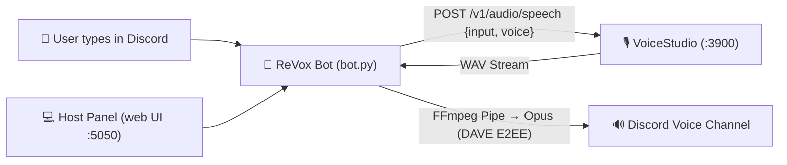

<div align="center">
  
  <h1>ReVox 🎙️</h1>
  <p><strong>Real-time local Discord TTS bot with voice cloning powered by VoiceStudio.</strong><br>
  <em>100% private, local-first, zero cloud subscriptions or API fees.</em></p>

  <p>
    <a href="#-your-voice-your-discord-your-pc">Features</a> ·
    <a href="#-install-with-ai-agent-prompt-recommended">Install with AI</a> ·
    <a href="#-manual-installation">Manual Installation</a> ·
    <a href="#-discord-slash-commands">Commands</a> ·
    <a href="#-quick-reference">Docs</a> ·
    <a href="#-faq--troubleshooting">Troubleshooting</a> ·
    <a href="LICENSE">License</a>
  </p>

  <p>
    <a href="https://github.com/John54571/ReVox-Bot/releases/latest"></a>
    <a href="LICENSE"></a>
    <a href="https://www.python.org/downloads/"></a>
    <a href="https://discordpy.readthedocs.io/"></a>
    <a href="https://github.com/debpalash/VoiceStudio"></a>
    
  </p>
</div>

---

## ⚡ Your Voice. Your Discord. Your PC.

| 🎙️ In Discord | 💻 On Host Dashboard | ⚡ Powered by VoiceStudio |
| :--- | :--- | :--- |
| Native slash commands (`/join`, `/say`, `/voice`) | One-click Start / Stop toggle | Real-time synthesis with local cloned voices |
| Real-time chat text-to-speech reading | In-browser audio preview player | Zero costs, subscriptions, or API rate limits |
| DAVE Protocol (E2EE 2026 standard) via `davey` | Live queue management and instant skip | In-RAM pipe streaming without temp disk files |
| Smart sanitization of URLs and code blocks | Live terminal logs with SSE streaming | Automatic backend discovery on `:3900` |

---

## 🤖 Install with AI Agent Prompt (Recommended)

If you use an AI coding assistant or autonomous agent (**Cursor**, **Claude Code**, **Antigravity**, **Codex**, **GitHub Copilot CLI**, etc.), simply paste this prompt into your terminal or chat window:

> 📋 **Prompt for your AI Agent:**
> ```text
> Clone and set up the project https://github.com/John54571/ReVox-Bot on my machine following the instructions in its AGENTS.md. Check system prerequisites (Python 3.11+ and FFmpeg), configure the virtual environment, initialize .env from .env.example, and run the script to create the desktop shortcut.
> ```

The agent will automatically read [`AGENTS.md`](AGENTS.md) inside the repository and set up the entire environment without requiring manual commands.

---

## 💻 Manual Installation

### 1. System Requirements (Windows)

Install Python 3.11+ and FFmpeg if you don't already have them on your system:

```powershell
winget install Python.Python.3.11
winget install Gyan.FFmpeg
```

> **Verification:** Open a new terminal and verify that `python --version` and `ffmpeg -version` return valid version strings.

Download and start **[VoiceStudio](https://voicestudio.sh)** (the local engine must be running on `http://127.0.0.1:3900`).

---

### 2. Create your Discord Bot

1. Open the [Discord Developer Portal](https://discord.com/developers/applications) and create a **New Application**.
2. Navigate to the **Bot** tab.
3. **Critical step:** Under *Privileged Gateway Intents*, enable **Message Content Intent** and save changes.
4. On the same page, click **Reset Token**, confirm, and copy your bot token.
5. Go to **OAuth2 → URL Generator**:
   - **Scopes:** `bot` and `applications.commands`.
   - **Bot Permissions:** `View Channels`, `Send Messages`, `Read Message History`, `Connect`, and `Speak`.
   - Open the generated invite link in your browser and invite the bot to your Discord server.

---

### 3. Clone and Configure Environment

```powershell
git clone https://github.com/John54571/ReVox-Bot.git
cd ReVox-Bot

# Create virtual environment and install dependencies
python -m venv .venv
.\.venv\Scripts\pip install -r requirements.txt

# Initialize configuration
copy .env.example .env
```

Configure your `.env` file:

```ini
DISCORD_TOKEN=paste_your_discord_token_here
VOICESTUDIO_URL=http://127.0.0.1:3900
VOICESTUDIO_VOICE=188d7f2b
MAX_CHARS=400
AUTOSTART=0
```

> 💡 **How to check available voices in your VoiceStudio?**
> With VoiceStudio open, run:
> ```powershell
> (Invoke-RestMethod http://127.0.0.1:3900/v1/audio/voices).voices | Where-Object type -eq "profile" | Format-Table voice_id, name, language
> ```
> *(Using the alphanumeric `voice_id` is recommended to ensure exact matching).*

---

### 4. Create Desktop Shortcut (Optional)

You can generate a desktop shortcut with the official ReVox icon:
- Double-click **`crear_acceso_directo.bat`**, or
- Run in PowerShell:
  ```powershell
  powershell -NoProfile -ExecutionPolicy Bypass -File .\crear_acceso_directo.ps1
  ```

---

### 5. Running the Application

You have two ways to run ReVox:

#### 🌟 Option A: Host Web Control Panel (Recommended)
Double-click your desktop shortcut or **`iniciar_panel.bat`**:
```powershell
.\.venv\Scripts\python panel.py
```
Your browser will automatically open at **`http://127.0.0.1:5050`**. From there you can:
- Start and stop the bot with a single click.
- Monitor VoiceStudio status and Discord gateway latency in real time.
- **Preview synthesized audio directly in your browser** with **🎧 Preview Audio** before sending it to Discord.
- Inspect active queues, skip tracks, or clear playback.
- View live console logs with severity filters (`INFO`, `WARN`, `ERROR`).
- Update bot settings or switch active voices on the fly without restarting.

#### ⚙️ Option B: Headless / Pure Terminal Mode
If you prefer running only the Discord bot without the web server:
```powershell
.\.venv\Scripts\python bot.py
```

---

<details>
<summary><strong>📐 System Architecture</strong> · Data Flow and Streaming</summary>



- Each Discord guild has an independent message queue.
- Audio flows from VoiceStudio into FFmpeg in RAM without writing temporary files to disk.
- Built-in text sanitization replaces URLs with *"link"* and code blocks with *"code block"*.
</details>

---

## 🎮 Discord Slash Commands

| Command | Parameters | Description |
|---|---|---|
| `/join` | *None* | Bot joins your current voice channel and listens to the text channel where invoked. *(Alias: `/entrar`)* |
| `/say` | `text` | Enqueues a one-off text to voice chat (useful from another text channel). *(Alias: `/decir`)* |
| `/voice` | `name` | Changes active voice profile (validates against real profiles in VoiceStudio). *(Alias: `/voz`)* |
| `/skip` | *None* | Immediately stops current playback and clears the guild's pending queue. *(Alias: `/saltar`)* |
| `/leave` | *None* | Disconnects the bot from the voice channel. *(Alias: `/salir`)* |

---

## 📚 Quick Reference

| If you need to... | See... |
|---|---|
| Automate installation with AI | [Install with AI Agent](#-install-with-ai-agent-prompt-recommended) · [`AGENTS.md`](AGENTS.md) |
| Configure the Discord application | [Step 2: Create your Discord Bot](#2-create-your-discord-bot) |
| Launch the web panel | [Step 5: Running](#5-running-the-application) · `iniciar_panel.bat` |
| Create a desktop shortcut | [Step 4: Desktop Shortcut](#4-create-desktop-shortcut-optional) · `crear_acceso_directo.bat` |
| Troubleshoot voice or intent errors | [FAQ & Troubleshooting](#-faq--troubleshooting) |
| Security policy and reporting | [`SECURITY.md`](SECURITY.md) |
| Contribution guide | [`CONTRIBUTING.md`](CONTRIBUTING.md) |
| Community code of conduct | [`CODE_OF_CONDUCT.md`](CODE_OF_CONDUCT.md) |
| License and third-party notices | [`LICENSE`](LICENSE) |

---

## ❓ FAQ & Troubleshooting

<details>
<summary><b>Error: <code>PrivilegedIntentsRequired</code></b></summary>
The Message Content intent is disabled. Go to <a href="https://discord.com/developers/applications">Discord Developer Portal</a> &gt; your Application &gt; <b>Bot</b> tab &gt; enable <b>Message Content Intent</b> under <i>Privileged Gateway Intents</i> and save changes.
</details>

<details>
<summary><b>Voice connection error: code 4017</b></summary>
Discord enforced the mandatory DAVE (E2EE) voice protocol in March 2026. Ensure you have installed <code>discord.py>=2.7.1</code> and <code>davey>=0.1.7</code> included in <code>requirements.txt</code>.
</details>

<details>
<summary><b>Bot connects to voice channel but makes no sound</b></summary>
Verify that FFmpeg is installed and accessible in your system PATH by opening a terminal and running <code>ffmpeg -version</code>.
</details>

<details>
<summary><b>Bot speaks in a generic voice instead of cloned voice</b></summary>
VoiceStudio falls back to the default engine voice when a provided voice identifier is not recognized. Make sure to use the alphanumeric <code>voice_id</code> (e.g. <code>188d7f2b</code>) in your <code>.env</code> rather than the display name.
</details>

<details>
<summary><b>Connection error: VoiceStudio Offline</b></summary>
Ensure VoiceStudio is open on your machine with a TTS model loaded. By default, its local API responds at <code>http://127.0.0.1:3900</code>.
</details>

---

## ⚖️ Legal Notices, Attributions & Ethical Use

### Attribution to VoiceStudio
ReVox is an independent open-source client that integrates with [VoiceStudio](https://github.com/debpalash/VoiceStudio) (created by Palash Deb and contributors, under AGPL-3.0) via its local HTTP loopback API (`http://127.0.0.1:3900`). ReVox **does not distribute, modify, or package binary weights or models from VoiceStudio**.

### Discord Trademark Notice
"Discord" is a registered trademark of Discord Inc. ReVox is an unofficial third-party application and is not affiliated with, endorsed by, or sponsored by Discord Inc. Usage must comply with the [Discord Developer Terms of Service](https://discord.com/developers/docs/policies-and-agreements/developer-terms-of-service).

### Ethical Voice Cloning Notice
Voice cloning and AI speech synthesis must **only be performed with explicit consent from the individual whose voice is being cloned**. Using this software for unauthorized impersonation, fraud, harassment, defamation, or any unlawful purpose is strictly prohibited.

---

<p align="center">
  Built with ❤️ for the VoiceStudio and Discord communities. Distributed under the <a href="LICENSE">MIT License</a>.
</p>
