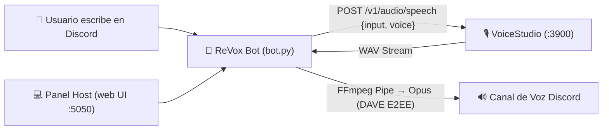

<div align="center">
  
  <h1>ReVox 🎙️</h1>
  <p><strong>Bot de Discord TTS con clonación de voz local en tiempo real usando VoiceStudio.</strong><br>
  <em>100% privado, local-first y sin suscripciones ni APIs de pago.</em></p>

  <p>
    <a href="#-tu-voz-tu-discord-tu-pc">Características</a> ·
    <a href="#-instalación-con-prompt-para-agentes-recomendado">Instalar con IA</a> ·
    <a href="#-instalación-manual">Instalación Manual</a> ·
    <a href="#-comandos-de-discord-slash-commands">Comandos</a> ·
    <a href="#-referencia-rápida">Docs</a> ·
    <a href="#-preguntas-frecuentes--solución-de-problemas">Troubleshooting</a> ·
    <a href="LICENSE">Licencia</a>
  </p>

  <p>
    <a href="https://github.com/John54571/ReVox-Bot/releases/latest"></a>
    <a href="LICENSE"></a>
    <a href="https://www.python.org/downloads/"></a>
    <a href="https://discordpy.readthedocs.io/"></a>
    <a href="https://github.com/debpalash/VoiceStudio"></a>
    
  </p>
</div>

---

## Tu voz. Tu Discord. Tu PC.

| 🎙️ En Discord | 💻 En el Panel Host | ⚡ Con VoiceStudio |
| :--- | :--- | :--- |
| Slash commands nativos (`/entrar`, `/decir`, `/voz`) | Control Encender / Apagar con 1 solo clic | Síntesis con voces clonadas locales |
| Lectura de canales de texto en tiempo real | Pre-escucha de audio TTS en el navegador | Cero costos ni límites de suscripción |
| Protocolo DAVE (E2EE 2026) con `davey` | Gestión y purga de colas en vivo | Transmisión en memoria RAM sin archivos temp |
| Sanitización inteligente de enlaces y código | Consola de logs en vivo con streaming SSE | Detección automática del servicio en `:3900` |

---

## 🤖 Instalación con Prompt para Agentes (Recomendado)

Si utilizás un asistente o agente de IA (**Cursor**, **Claude Code**, **Antigravity**, **Codex**, **GitHub Copilot CLI**, etc.), simplemente pegale este prompt en una terminal o ventana de chat:

> 📋 **Prompt para tu Agente de IA:**
> ```text
> Cloná e instalá el proyecto https://github.com/John54571/ReVox-Bot en mi máquina siguiendo las instrucciones de su AGENTS.md. Verificá los prerrequisitos del sistema (Python 3.11+ y FFmpeg), configurá el entorno virtual, inicializá .env a partir de .env.example y ejecutá el script para generar el acceso directo en mi Escritorio.
> ```

El agente leerá automáticamente [`AGENTS.md`](AGENTS.md) dentro del repositorio y dejará todo configurado y funcionando sin que tengas que ejecutar comandos manuales.

---

## 💻 Instalación Manual

### 1. Requisitos del Sistema (Windows)

Instalá Python 3.11+ y FFmpeg si aún no los tenés en tu sistema:

```powershell
winget install Python.Python.3.11
winget install Gyan.FFmpeg
```

> **Verificación:** Abrí una terminal nueva y comprobá que `python --version` y `ffmpeg -version` devuelvan sus respectivas versiones.

Descargá y abrí **[VoiceStudio](https://voicestudio.sh)** (el backend local debe estar corriendo en `http://127.0.0.1:3900`).

---

### 2. Crear tu Bot en Discord

1. Ingresá a [Discord Developer Portal](https://discord.com/developers/applications) y creá una aplicación (**New Application**).
2. Andá a la pestaña **Bot**.
3. **Paso crítico:** Activá el interruptor **Message Content Intent** dentro de *Privileged Gateway Intents* y guardá los cambios.
4. En esa misma pantalla tocá **Reset Token**, confirmá y copiá el token generado.
5. Andá a **OAuth2 → URL Generator**:
   - **Scopes:** `bot` y `applications.commands`.
   - **Bot Permissions:** `View Channels`, `Send Messages`, `Read Message History`, `Connect` y `Speak`.
   - Abrí el enlace generado e invitá al bot a tu servidor de Discord.

---

### 3. Clonar y Configurar el Entorno

```powershell
git clone https://github.com/John54571/ReVox-Bot.git
cd ReVox-Bot

# Crear entorno virtual e instalar dependencias
python -m venv .venv
.\.venv\Scripts\pip install -r requirements.txt

# Inicializar configuración
copy .env.example .env
```

Configurá tu archivo `.env`:

```ini
DISCORD_TOKEN=pega_aqui_tu_token_de_discord
VOICESTUDIO_URL=http://127.0.0.1:3900
VOICESTUDIO_VOICE=188d7f2b
MAX_CHARS=400
AUTOSTART=0
```

> 💡 **¿Cómo ver las voces disponibles en tu VoiceStudio?**
> Con VoiceStudio abierto, ejecutá:
> ```powershell
> (Invoke-RestMethod http://127.0.0.1:3900/v1/audio/voices).voices | Where-Object type -eq "profile" | Format-Table voice_id, name, language
> ```
> *(Se recomienda usar el `voice_id` alfanumérico para garantizar la coincidencia exacta).*

---

### 4. Crear Acceso Directo en el Escritorio (Opcional)

Podés generar un acceso directo en tu Escritorio de Windows con el icono oficial del bot:
- Hacé doble clic en **`crear_acceso_directo.bat`**, o
- Ejecutá en PowerShell:
  ```powershell
  powershell -NoProfile -ExecutionPolicy Bypass -File .\crear_acceso_directo.ps1
  ```

---

### 5. Ejecución

Tenés dos formas de iniciar ReVox:

#### 🌟 Opción A: Con Panel Web de Control (Recomendado para el Host)
Hacé doble clic en el acceso directo de tu Escritorio o en **`iniciar_panel.bat`**:
```powershell
.\.venv\Scripts\python panel.py
```
Se abrirá automáticamente tu navegador en **`http://127.0.0.1:5050`**. Desde allí podés:
- Encender y detener el bot con un solo clic.
- Ver el estado de VoiceStudio y la latencia a Discord en tiempo real.
- **Probar el audio directamente en tu navegador** con el botón **🎧 Probar Audio** antes de mandarlo a Discord.
- Monitorear colas de reproducción, pausar o saltar mensajes.
- Ver los logs en vivo con filtros de severidad (`INFO`, `WARN`, `ERROR`).
- Modificar el token o la voz activa en caliente sin reiniciar.

#### ⚙️ Opción B: Modo Headless / Terminal Pura
Si preferís correr solo el bot sin servidor web:
```powershell
.\.venv\Scripts\python bot.py
```

---

<details>
<summary><strong>📐 Arquitectura del Sistema</strong> · Flujo de Datos y Transmisión</summary>



- Cada servidor tiene su propia cola de mensajes gestionada de forma independiente.
- El audio pasa de VoiceStudio a FFmpeg en memoria RAM sin escribir archivos temporales en disco.
- Incorpora sanitización inteligente de mensajes (reemplazo de URLs por *"enlace"* y bloques de código por *"bloque de código"*).
</details>

---

## 🎮 Comandos de Discord (Slash Commands)

| Comando | Parámetros | Descripción |
|---|---|---|
| `/entrar` | *Ninguno* | El bot se une a tu canal de voz actual y lee el canal de texto donde ejecutaste el comando. |
| `/decir` | `texto` | Envía un mensaje puntual a la cola de voz (útil desde otros canales de texto). |
| `/voz` | `nombre` | Cambia la voz activa (acepta nombre o ID y valida contra los perfiles reales de VoiceStudio). |
| `/saltar` | *Ninguno* | Corta inmediatamente la reproducción actual y vacía la cola pendiente del servidor. |
| `/salir` | *Ninguno* | Desconecta al bot del canal de voz. |

---

## 📚 Referencia Rápida

| Si necesitás... | Consultá... |
|---|---|
| Automatizar la instalación con IA | [Instalar con Agente](#-instalación-con-prompt-para-agentes-recomendado) · [`AGENTS.md`](AGENTS.md) |
| Configurar el bot en Discord | [Paso 2: Crear tu Bot](#2-crear-tu-bot-en-discord) |
| Iniciar el panel web con un clic | [Paso 5: Ejecución](#5-ejecución) · `iniciar_panel.bat` |
| Crear acceso directo con icono oficial | [Paso 4: Acceso Directo](#4-crear-acceso-directo-en-el-escritorio-opcional) · `crear_acceso_directo.bat` |
| Solucionar errores de voz o intents | [Preguntas Frecuentes](#-preguntas-frecuentes--solución-de-problemas) |
| Política de seguridad y reporte de fallos | [`SECURITY.md`](SECURITY.md) |
| Guía para contribuir al código | [`CONTRIBUTING.md`](CONTRIBUTING.md) |
| Código de conducta de la comunidad | [`CODE_OF_CONDUCT.md`](CODE_OF_CONDUCT.md) |
| Licencia y avisos de terceros | [`LICENSE`](LICENSE) |

---

## ❓ Preguntas Frecuentes & Solución de Problemas

<details>
<summary><b>Error: <code>PrivilegedIntentsRequired</code></b></summary>
Falta habilitar el permiso de lectura de mensajes. Andá a <a href="https://discord.com/developers/applications">Discord Developer Portal</a> &gt; tu Bot &gt; sección <b>Bot</b> &gt; activá <b>Message Content Intent</b> y guardá los cambios.
</details>

<details>
<summary><b>Error de conexión de voz: código 4017</b></summary>
Discord implementó el protocolo obligatorio DAVE (E2EE) en marzo de 2026. Asegurate de tener instalados <code>discord.py>=2.7.1</code> y <code>davey>=0.1.7</code> incluidos en <code>requirements.txt</code>.
</details>

<details>
<summary><b>El bot entra al canal pero no emite sonido</b></summary>
Verificá que FFmpeg esté correctamente instalado y en el PATH del sistema abriendo una terminal y ejecutando <code>ffmpeg -version</code>.
</details>

<details>
<summary><b>Habla con una voz genérica en lugar de mi voz clonada</b></summary>
VoiceStudio aplica una voz genérica por defecto cuando no reconoce el identificador enviado. Asegurate de usar el <code>voice_id</code> alfanumérico (ej: <code>188d7f2b</code>) en tu <code>.env</code> en lugar del nombre visible.
</details>

<details>
<summary><b>Fallo de conexión: VoiceStudio Offline</b></summary>
Asegurate de que VoiceStudio esté abierto en tu computadora y con un modelo de TTS seleccionado. Por defecto atiende en <code>http://127.0.0.1:3900</code>.
</details>

---

## ⚖️ Avisos Legales, Atribuciones y Uso Ético

### Atribución a VoiceStudio
ReVox es un cliente independiente de código abierto que se integra con [VoiceStudio](https://github.com/debpalash/VoiceStudio) (creado por Palash Deb y colaboradores, bajo licencia AGPL-3.0) mediante su API HTTP local loopback (`http://127.0.0.1:3900`). ReVox **no distribuye, modifica ni empaqueta binarios ni pesos de modelos de VoiceStudio**.

### Términos de Servicio de Discord
"Discord" es una marca registrada de Discord Inc. ReVox es un desarrollo de terceros no oficial y no está afiliado, respaldado ni patrocinado por Discord Inc. El uso de este bot debe cumplir con los [Términos de Servicio para Desarrolladores de Discord](https://discord.com/developers/docs/policies-and-agreements/developer-terms-of-service).

### Uso Ético de la Clonación de Voz
La clonación y síntesis de voz mediante inteligencia artificial debe realizarse **únicamente con el consentimiento explícito de la persona cuya voz se recrea**. Queda expresamente prohibido el uso de este software para suplantación de identidad no autorizada, fraude, acoso, difamación o cualquier fin que vulnere la legislación vigente o los derechos de privacidad de terceros.

---

<p align="center">
  Hecho con ❤️ para la comunidad de VoiceStudio y Discord. Distribuido bajo licencia <a href="LICENSE">MIT</a>.
</p>
